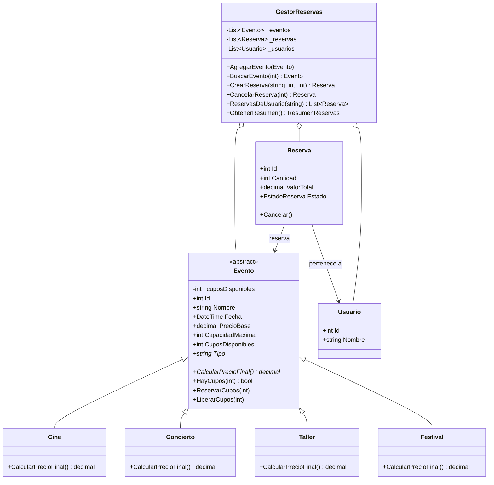

# PLANAZO-POO-CSharp

Aplicación de consola en **C# / .NET 8** para gestionar los eventos de PLANAZO (cine, conciertos, talleres y festivales): consultar eventos, reservar entradas, controlar cupos y cancelar reservas. Proyecto del parcial de Programación Orientada a Objetos.

## Funcionalidades

- Ver y consultar eventos (7 precargados: 2 cines, 2 conciertos, 2 talleres y 1 festival).
- Reservar entradas validando cantidad y cupos.
- Ver reservas, cancelar reservas (devuelve cupos, no permite cancelar dos veces).
- Resumen de reservas activas: cantidad, entradas y valor total.
- **Reto 2:** consultar las reservas de un usuario (opción 7).
- Opción 8: ejecuta automáticamente los 7 casos de prueba del enunciado.
- Las operaciones incorrectas se controlan con excepciones y **no cierran el programa**.

## Cómo ejecutarlo

Requisito: [.NET SDK 8](https://dotnet.microsoft.com/download).

```bash
git clone https://github.com/<yojaner123>/PLANAZO-POO-CSharp.git
cd PLANAZO-POO-CSharp
dotnet run
```

## Estructura

```text
PLANAZO-POO-CSharp/
├── Program.cs                 # Menú de consola (solo interacción con el usuario)
├── Modelos/
│   ├── Evento.cs              # Clase abstracta
│   ├── Cine.cs / Concierto.cs / Taller.cs
│   ├── Festival.cs            # Reto 1
│   ├── Usuario.cs             # Reto 2
│   ├── EstadoReserva.cs
│   └── Reserva.cs
├── Servicios/
│   ├── GestorReservas.cs      # Lógica y colecciones List<T>
│   └── CasosDePrueba.cs       # Los 7 casos de prueba
├── Capturas/
└── README.md
```

## Clases y relaciones

| Clase | Responsabilidad |
|---|---|
| `Evento` (abstracta) | Datos comunes (id, nombre, fecha, precio base, capacidad, cupos) y control de cupos. Declara `CalcularPrecioFinal()` abstracto. |
| `Cine` | Precio final = precio base. |
| `Concierto` | Precio final = base + 15 %. |
| `Taller` | Precio final = base − 10 %. |
| `Festival` (reto 1) | Precio final = base + 25 % + $10.000 de servicio. |
| `Usuario` (reto 2) | Identifica a quien reserva. |
| `Reserva` | Asocia un `Usuario` con un `Evento`; guarda cantidad, valor total y estado. |
| `GestorReservas` | Contiene las listas de eventos, reservas y usuarios y orquesta las operaciones. |

Relaciones: `Cine`, `Concierto`, `Taller` y `Festival` **heredan** de `Evento`. `Reserva` **se asocia** con un `Evento` y un `Usuario`. `GestorReservas` **compone** (contiene) listas de `Evento`, `Reserva` y `Usuario`.

## Conceptos de POO aplicados

- **Clases y objetos:** `Evento`, `Reserva`, `Usuario`, `GestorReservas`.
- **Constructores:** validan los datos al crear el objeto (`Evento`, `Reserva`, `Usuario`); los hijos llaman a `base(...)`.
- **Encapsulamiento:** `_cuposDisponibles` es privado y solo cambia con `ReservarCupos` y `LiberarCupos`; `Reserva.Estado` tiene `private set`; el gestor expone `IReadOnlyList<T>`, no las listas internas.
- **Abstracción:** `Evento` es abstracta; define *qué* debe hacer todo evento (`CalcularPrecioFinal`) sin decir *cómo*.
- **Herencia:** `Cine`, `Concierto`, `Taller` y `Festival` reutilizan todo lo de `Evento`.
- **Polimorfismo:** `Reserva` y el menú llaman a `evento.CalcularPrecioFinal()` sin saber el tipo concreto; cada clase responde con su regla.
- **Composición y asociaciones:** `GestorReservas` ↔ `Reserva` ↔ `Evento`/`Usuario`.
- **Colecciones:** `List<Evento>`, `List<Reserva>`, `List<Usuario>`.
- **Excepciones:** `ArgumentException` (datos inválidos), `InvalidOperationException` (sin cupos, doble cancelación), `KeyNotFoundException` (evento o reserva inexistente) y `FormatException` (entrada no numérica), todas capturadas en `Program.cs`.
- Valores monetarios con `decimal`.

## Diagrama UML (Reto 3)

Un diagrama de clases UML representa las clases de un sistema (nombre, atributos y métodos) y las relaciones entre ellas (herencia, asociación, composición).




|---|---|
| Menú principal | 
| 1. Reserva válida | 
| 2. Más entradas que cupos | 
| 3. Cantidad negativa | 
| 4. Cancelar y devolver cupos | 
| 5. Cancelar dos veces | 
| 6. Evento inexistente | 
| 7. Precios por tipo | 

## Pregunta de sustentación

**¿Por qué utilizaste una clase abstracta `Evento` en lugar de crear clases completamente independientes para Cine, Concierto y Taller? ¿Qué ventajas tiene esta decisión cuando necesitamos agregar un nuevo tipo de evento?**

Porque los tres tipos comparten datos y comportamiento (id, nombre, fecha, precio base, capacidad, cupos y la lógica de reservar o liberar cupos) y solo se diferencian en **cómo calculan el precio final**. Con una clase abstracta escribo lo común una sola vez en `Evento` y obligo a cada hijo a implementar únicamente lo propio con `public abstract decimal CalcularPrecioFinal();`. Si fueran clases independientes, tendría que duplicar los campos y la validación de cupos en cada una, y una corrección habría que hacerla tres veces.

Además, gracias al polimorfismo, `Reserva` calcula su total con `evento.CalcularPrecioFinal() * cantidad` y `GestorReservas` guarda todo en una sola `List<Evento>`, sin `if` ni `switch` según el tipo.

**Ventaja al agregar un nuevo tipo:** basta con crear una clase que herede de `Evento` e implemente `Tipo` y `CalcularPrecioFinal()`. Lo demostré con `Festival` (`PrecioBase * 1.25m + 10000m`): no modifiqué `Evento`, `Cine`, `Concierto`, `Taller`, `Reserva` ni el menú, y el nuevo evento ya se puede listar, reservar y cancelar. Esto cumple el principio abierto/cerrado: el sistema está abierto a extensión y cerrado a modificación.
